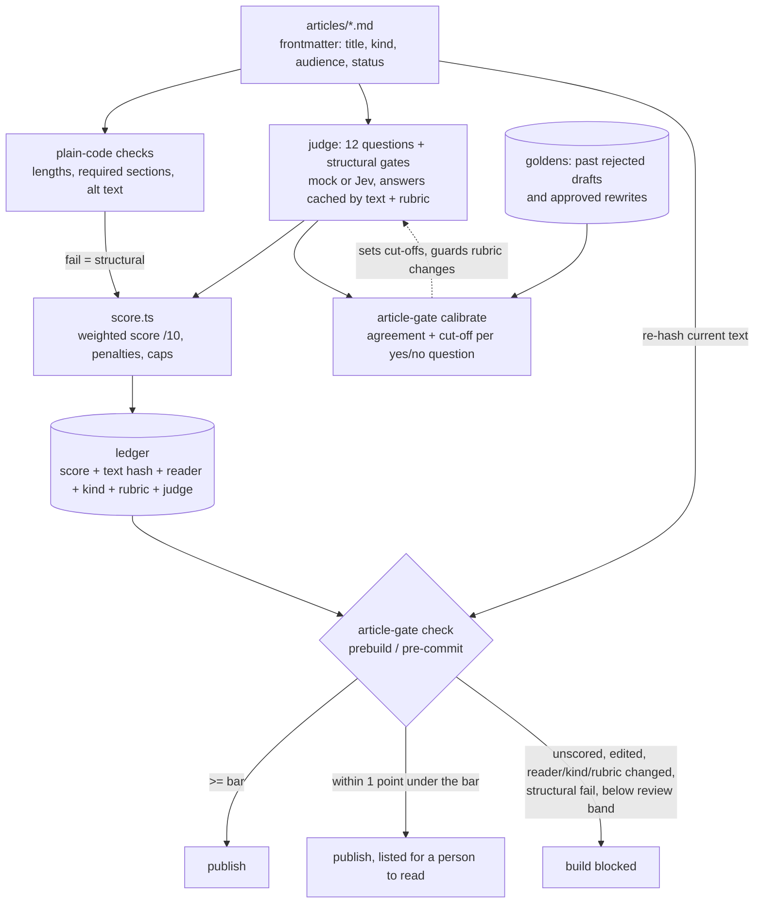

# article-quality-gate

A publishing gate for markdown articles: plain-code checks plus an LLM judge score each article out of
10, each score is saved with a hash of the text it judged, and a `prebuild` check blocks the build when a
published article is unscored, edited since it was scored, or below the bar. A calibration command checks
the judge against the author's own past verdicts.

Framework-agnostic: it reads `.md` / `.mdx` files with YAML frontmatter from any folder, so it works in
front of Next.js, Astro, Hugo, Eleventy or a plain docs folder. It runs keyless with a mock judge; set
`JUDGE=jev` for real scores.

## The problem

AI helps write a lot of published text now, and "an AI read it and said it was fine" is not a check. A
useful article gate needs to:

- give the same article the same score, so a decision does not depend on which run you got;
- make sure the score belongs to the words being published, not to an earlier draft;
- leave a human in the loop for the borderline cases, without asking them to read everything;
- show whether the judge agrees with the author, not just whether it is consistent.

A single "rate this article 1-10" prompt does none of these. The score drifts towards the middle, the
policy is buried in the prompt, nothing ties a score to a version of the text, and there is no way to tell
whether it would have caught the drafts the author actually rejected.

## Approach

Split the work by what each part is good at. The method follows the
[G-Eval paper](https://arxiv.org/abs/2303.16634) (Liu et al., 2023: grade against written criteria and
weight by the model's confidence in each answer) and three practices from
[DeepEval](https://deepeval.com/docs/metrics-introduction): fix the scale, break a judgment into small
decisions, and check the judge against examples with known answers.

- **Plain code** checks anything with an exact answer: frontmatter, title and description length, word
  and section counts, required sections per reader, image alt text, hype phrases.
- **The judge** answers twelve narrow questions (`src/rubric.ts`), each with fixed score bands:
  - substance: is the claim specific and arguable, is the evidence first-hand, will the reader recognise
    their problem? (0-2 each)
  - delivery: does the opening create tension, does every paragraph earn its place, is the ending the
    sharpest part? (0-2 each)
  - fit for the reader: is it plain enough, is there a practical takeaway? (0-3 each)
  - penalties (yes/no probabilities): overclaiming, writing for the wrong reader, an uncredited
    borrowed idea, not delivering what the title promises.
- **Plain code, not the model, computes the score**: `4 x substance/6 + 3 x delivery/6 + 3 x fit/6`
  minus penalties. Weak substance or weak delivery caps the score just under the bar whatever the other
  answers say.
- **Structural gates** run before quality is graded: narrow yes/no questions that each encode a way a
  past draft went wrong, with a cut-off set by calibration. Over the cut-off, the article fails outright.
- **A ledger** (`.quality/article-scores.json`) stores each score with a hash of the title, description
  and body, plus the reader profile, article kind, rubric version and judge. The gate recomputes the hash
  and rejects any score whose text, reader, kind or rubric no longer matches.
- **The gate** (`article-gate check`) reads only the ledger, so it costs nothing and runs in a second.



Thresholds (`article-gate.config.json`):

| | Bar | Review band | Below |
|---|---|---|---|
| Default | 8.0 | 7.0-7.9: publishes, listed for review | blocked |
| `kind: company` | 7.0 | 6.0-6.9 | blocked |

The judge is pluggable (`src/judges/`):

| `JUDGE=` | What it is | Needs |
|---|---|---|
| `mock` (default) | Local, deterministic word-count and phrase heuristics in the same answer shape. It exists so the scoring maths, ledger, gate, cache, calibration and tests run anywhere for free. Its numbers say nothing about real quality. | nothing |
| `jev` | Jev, TypeSafe's System One model: one request, all questions answered in parallel, each as a probability distribution over the fixed bands. Pinned to `jev-1.13.0` with a direct key, or via Vercel AI Gateway (unversioned). | `TYPESAFE_API_KEY` or `AI_GATEWAY_API_KEY` |

Any other model can be added by implementing the `Judge` interface in `src/judges/types.ts`: take the
article, return the twelve answers plus one probability per structural gate.

## Results

These numbers were measured on the author's own site with the Jev judge, and are copied from the
article linked below. They are **not** reproduced by the synthetic samples in this repo.

**The gate in use.** 32 articles are published, scoring between 7.1 and 9.6. The bar is 8; company
profiles have a lower bar of 7.

**Test 1: does the score hold still?** Six published articles were each scored five times. The largest
gap between one article's runs was 0.2 points; three articles scored within 0.1 point every time, and two
scored identically all five times. Asking twice and taking the median would add cost without changing a
decision. (`npm run stability` runs the same test.)

**Test 2: does it agree with the author?** Seven versions of articles that the author had rejected and
rewritten were pulled from git history and scored for the reader each article is written for.

| Rejected version | Why it was rejected | Score | Gate |
|---|---|---|---|
| 1 | Weak model section, generic claims | 5.3 | Failed |
| 2 | A section addressed to one kind of reviewer, ending "DM me" | 9.1 | Passed |
| 3 | A CV-style skills list and a "compare notes" sign-off | 9.1 | Passed |
| 4 | A CV-style skills list | 9.0 | Passed |
| 5 | "The relevant skill was..." written to one kind of reviewer | 9.0 | Passed |
| 6 | A CV-style skills list | 8.6 | Passed |
| 7 | A CV-style skills list | 8.2 | Passed |

The gate failed the one badly written version and passed the six that were well written but spoke to the
wrong person. Their approved rewrites scored about the same, between 8.3 and 9.7. The quality questions
measure how well something is written; none of them asks whether a section reads as an internal note.

**Test 3: one narrow question.** One yes/no question was put to the same seven pairs: does any section
read as an internal note rather than a public article (addressing one kind of reviewer directly, a CV-style
skills list, asking the reader to DM)?

- Version 2: 0.85 before the rewrite, 0.26 after.
- Version 3: 0.81 before, 0.08 after.
- The other four (versions 4-7): between 0.12 and 0.38, before and after alike.
- Every approved version: 0.38 or lower.

A cut-off at 0.6 would have caught the two most obvious cases with no false alarms on approved writing,
and missed the quieter skills-list cases. That question is the `internal_note` structural gate in
`src/rubric.ts`, at 0.6.

**What changed as a result.** The original fingerprint covered only the words, so changing an article's
intended reader did not invalidate its score; the ledger now records reader and kind, and the gate flags a
mismatch. At the time of writing, a structural gate before the score and a permanent test set of rejected
versions were the next steps. This repo implements both (`STRUCTURAL_GATES` and `npm run calibrate`).

## Quickstart

Needs Node 22.9 or later. About two minutes, no keys.

```bash
npm install
npm run quickstart     # score the samples (mock judge), calibrate against goldens, run the gate
npm test               # 24 tests: scoring maths, ledger invalidation, gate, calibration, cache
npm run build          # prebuild runs `check --strict`: blocked by samples 04 and 05
```

What the quickstart shows with the mock judge, on the six **synthetic** samples in `samples/articles/`:

| Sample | Intended | Mock result |
|---|---|---|
| 01 three numbers before automating quotes | good essay | 9.3 pass |
| 02 bike shop quote turnaround (fictional shop) | good case study | 8.9 pass |
| 03 notes from a month of call logs | thin but honest | 7.6 review |
| 04 "10 ways AI will revolutionize your business" | deliberately bad | 0.0 fail |
| 05 testing a ticket router | well written, ends as an internal note | 7.0 fail (`internal_note` gate; 8.3 without it) |
| 06 draft | `status: draft` | skipped |

Calibration against `calibration/goldens.json` (seven versions with the author's verdict, including a
rejected first draft of 01 and the approved rewrite of 05) reproduces the shape of Test 2 and Test 3: the
score alone agrees on 6 of 7 and misses version 05; with the structural gate it agrees on 7 of 7 with no
false alarm on an approved version. With the mock judge this is by construction; it demonstrates the
method, not a result.

Real scores:

```bash
cp .env.example .env   # set JUDGE=jev and TYPESAFE_API_KEY (or AI_GATEWAY_API_KEY)
npm run score -- --fresh
npm run calibrate
npm run stability -- --runs 5
```

Judge answers are cached by rubric version, judge and text, so re-running after changing a threshold
makes no new calls.

### Use it in your own project

1. Copy `src/`, `article-gate.config.json` and the `package.json` scripts. Point `contentDirs` at your
   articles. Frontmatter: `title`, `description`, `date`, `kind` (`essay`, `case-study`, `field-note`,
   `company`), optional `audience` (`general` default, or `technical`) and `status: draft`.
2. Rewrite `src/rubric.ts` for your readers and voice. Bump `RUBRIC_VERSION` on every change: it
   invalidates the cache and every ledger entry.
3. `npm run score`, then commit `.quality/article-scores.json`. It is the record the gate checks.
4. Add `"prebuild": "article-gate check --strict"` (or `node --import tsx src/cli.ts check --strict`).
   Optionally install `hooks/pre-commit`, which checks only staged articles.
5. Build your goldens from git history: for each article you rewrote, the version before the rewrite is
   a rejection and the published version an approval. Write down why. Run `npm run calibrate` after every
   rubric change and keep it failing the rejections it should.

`article-gate check` without `--strict` only reminds, which is useful in local dev.

## Repo layout

```
article-gate.config.json   content dirs, ledger path, bar, per-kind bars, review margin
src/
  cli.ts                   score | check | calibrate | stability
  rubric.ts                EXAMPLE rubric: reader profiles, 12 questions, bands, weights, structural gates
  deterministic.ts         plain-code checks
  score.ts                 answers -> score /10, caps, pass / review / fail
  judges/                  Judge interface, mock judge, Jev judge
  ledger.ts                text hash and ledger read/write
  check.ts                 the gate (pure, no judge calls)
  runner.ts                score articles through the cache, record to the ledger
  cache.ts                 answer cache keyed by rubric + judge + text
  calibrate.ts             judge vs author: agreement and cut-off per yes/no question
  stability.ts             repeat-run spread
  report.ts                markdown + JSON reports in reports/
samples/articles/          6 SYNTHETIC articles (2 good, 1 borderline, 2 bad, 1 draft)
calibration/               goldens.json + 2 extra SYNTHETIC versions (a rejected draft, an approved rewrite)
.quality/article-scores.json  ledger (mock-judged synthetic samples)
hooks/pre-commit           blocks commits that change a failing article
test/                      node:test suite
```

## Design decisions / what I'd do next

- **The model answers questions; code makes the decision.** Weights, caps, bars and cut-offs are named
  constants. Changing one is a code review, and re-running with cached answers is free.
- **Fixed bands, probabilities, one request.** Each score question has labelled bands, and the judge
  returns an expected value over them, so scores are stable run to run. The article text is passed as
  data, never spliced into the instructions.
- **The hash covers the words; reader and kind sit next to it.** The original hash covered only the
  words, which let a reader change keep an old score. Storing them separately lets the gate say exactly
  what changed.
- **A review band instead of a hard line.** One point under the bar publishes but is listed for a person.
  That keeps a borderline judgment with the author without blocking a release over 0.1 points.
- **Consistency is not correctness.** Stability and calibration are separate commands because they
  answer different questions.
- **Next: fact checks.** The gate does not check facts. Checking each claim against a record of sources,
  the way DeepEval's faithfulness metric checks an answer against its documents, is the larger piece of
  work left.
- **Next: more structural gates from more goldens.** The quieter skills-list cases were missed by the
  0.6 cut-off. More labelled examples, or a more specific question, are needed before tightening it.
- **Left out of this repo:** the original also judged rendered site pages line by line in a headless
  browser (plain language, relevance, hype, button clarity). That depends on a running site and is not
  part of the article gate.

## Article

[An AI quality gate for every article, and the six it should have failed](https://tonytonggg.com/writing/an-ai-quality-gate-for-every-article)

## Licence

MIT, copyright Tony Tong. Uses [`@typesafe-ai/sdk`](https://www.npmjs.com/package/@typesafe-ai/sdk)
(MIT) and [`gray-matter`](https://www.npmjs.com/package/gray-matter) (MIT) as dependencies.
